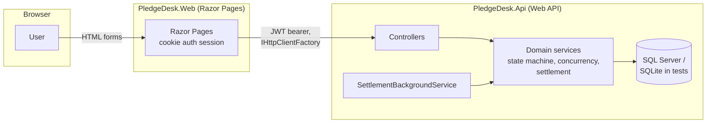

# PledgeDesk

[](https://github.com/edu-tech220/pledgedesk/actions/workflows/ci.yml)


A crowdfunding campaign platform: creators launch a campaign with a funding goal and
optional reward tiers, backers pledge money, and the platform enforces an
**all-or-nothing** funding rule - a campaign only keeps the money if it reaches its
goal before the deadline, otherwise every pledge is refunded automatically.

Built as two independent ASP.NET Core 8 services - a Web API microservice with the
business rules and a Razor Pages frontend that consumes it - to demonstrate a small,
realistic microservices split rather than a single monolith.

**Stack:** C# / .NET 8 · ASP.NET Core Web API · ASP.NET Core Razor Pages · Entity
Framework Core · SQL Server (SQLite in tests) · JWT auth (PBKDF2 password hashing) ·
`BackgroundService` · xUnit · Docker / Docker Compose · GitHub Actions

## What it solves

Crowdfunding sounds simple until you have to answer:

- What happens to the money if a campaign doesn't reach its goal?
- What stops two backers from claiming the same last unit of a limited reward?
- Who is allowed to activate, close or see the backers of a campaign?
- How do you keep the public campaign list fast without an N+1 query per card?

PledgeDesk answers all four with actual code, not just CRUD.

## Business rules

- **Campaign lifecycle state machine** - `Draft -> Active -> (Funded | Failed) -> Closed`.
  Every transition is validated in one place (`CampaignStateMachine`): a campaign can only
  be activated from Draft with a positive goal and a future deadline, pledges are only
  accepted while Active and before the deadline, and settlement/closing only happen from
  the expected prior state.
- **Reward tier stock under concurrency** - claiming a limited reward tier decrements its
  stock using EF Core's `rowversion` optimistic concurrency token. If two backers race for
  the last unit, the loser's save fails with a concurrency conflict; the service reloads
  the tier's current stock, re-checks the rule, and either retries or reports
  `reward_tier_sold_out` - never oversold stock.
- **All-or-nothing settlement** - a `BackgroundService` polls for campaigns past their
  deadline every 30 seconds. If confirmed pledges reached the goal, the campaign becomes
  `Funded`; otherwise it becomes `Failed` and every confirmed pledge is automatically
  marked `Refunded`. Settlement only touches `Active` campaigns past their deadline, so
  re-running it (or crashing mid-run) is naturally idempotent - nothing gets refunded or
  funded twice. Admins can also trigger a run on demand from the dashboard.
- **Role-based authorization** - JWT bearer auth with three roles (`Backer`, `Creator`,
  `Admin`). Self-registration can only create a Backer or Creator account; the Admin role
  is seed-only, so there's no way to escalate privileges through the public API.
- **Pagination everywhere that lists grow** - campaign listings, a campaign's pledges, a
  backer's pledge history and the admin campaign list are all paginated server-side.

## Architecture



The frontend never talks to the database directly - it only calls the API over HTTP,
carrying the backend JWT as a claim on its own cookie session. This keeps the two
services independently deployable and lets the API be reused by any other client.

## Technical decisions

- **Money stored as integer cents.** SQLite (used by the test suite) has no native decimal
  column type and cannot run `SUM()` over the TEXT-encoded values EF Core's provider uses
  for `decimal`. A `ValueConverter` maps `decimal <-> long` cents so pledged-amount
  aggregates work identically on SQL Server and SQLite - caught by the integration tests,
  not assumed.
- **Cookie session on the frontend, JWT on the backend.** The Razor Pages app signs the
  user into its own cookie-auth scheme after calling `/api/auth/login`, storing the
  backend's JWT as a claim. A `DelegatingHandler` reads that claim and attaches it as a
  Bearer token on every outgoing call to the API - the frontend never exposes the token to
  the browser.
- **Optimistic concurrency over locking.** Reward tier stock and every other mutable row
  carry a `rowversion` column instead of using explicit locks, so normal traffic never
  blocks; only genuine races pay the cost of a retry.
- **Idempotent settlement by construction.** Rather than a separate idempotency-key table,
  settlement's query (`Active` + past deadline) naturally excludes campaigns it already
  processed, so the background timer, a crash-and-restart, and the admin's manual trigger
  can never double-settle or double-refund.

## Endpoints

| Method | Route | Auth | Description |
|---|---|---|---|
| POST | `/api/auth/register` | - | Register as Backer or Creator |
| POST | `/api/auth/login` | - | Log in, returns a JWT |
| GET | `/api/campaigns` | - | Paginated campaign list (filter by status/category) |
| GET | `/api/campaigns/{id}` | - | Campaign detail with reward tiers |
| GET | `/api/campaigns/mine` | Creator | The caller's own campaigns |
| POST | `/api/campaigns` | Creator | Create a Draft campaign |
| POST | `/api/campaigns/{id}/reward-tiers` | Creator (owner) | Add a reward tier (Draft only) |
| POST | `/api/campaigns/{id}/activate` | Creator (owner) | Draft -> Active |
| POST | `/api/campaigns/{id}/close` | Creator (owner) | Funded -> Closed, collects pledges |
| POST | `/api/campaigns/{id}/pledges` | Backer | Pledge to an Active campaign |
| GET | `/api/campaigns/{id}/pledges` | Creator (owner) / Admin | Paginated pledge list for a campaign |
| GET | `/api/pledges/mine` | Backer | The caller's own pledge history |
| GET | `/api/admin/campaigns` | Admin | All campaigns, any status |
| POST | `/api/admin/settlement/run` | Admin | Force a settlement run on demand |

Full request/response schemas are in Swagger at `/swagger` when running the API.

## Running it

### Docker Compose (API + Web + SQL Server)

```bash
docker compose up --build
```

- Web: http://localhost:8081
- API + Swagger: http://localhost:8080/swagger

### Locally with `dotnet run`

```bash
dotnet run --project src/PledgeDesk.Api
dotnet run --project src/PledgeDesk.Web
```

The Web project's `appsettings.json` already points `Api:BaseUrl` at the API's HTTP
launch profile port, so both run with no extra configuration. The API applies pending EF
Core migrations and seeds a demo admin account on startup (skipped in the `Testing`
environment used by the integration tests).

**Demo admin account:** `admin@pledgedesk.dev` / `Admin#12345`

## Testing

```bash
dotnet test
```

45 xUnit tests, no external services required:

- Domain unit tests for the campaign state machine (every legal and illegal transition).
- Service tests against an isolated in-memory SQLite database per test, including a test
  that races two `DbContext` instances against the same reward tier to force the
  optimistic concurrency retry path.
- `WebApplicationFactory` integration tests that boot the real API pipeline (controllers,
  JWT auth, middleware) against SQLite, covering role-based 401/403 responses and a full
  create -> activate -> pledge -> settle lifecycle that ends in a refunded pledge.

## Project structure

```
src/PledgeDesk.Api/     ASP.NET Core Web API - domain, EF Core, controllers, background worker
src/PledgeDesk.Web/     ASP.NET Core Razor Pages frontend, consumes the API via IHttpClientFactory
tests/PledgeDesk.Api.Tests/   xUnit tests (unit + WebApplicationFactory integration)
```
